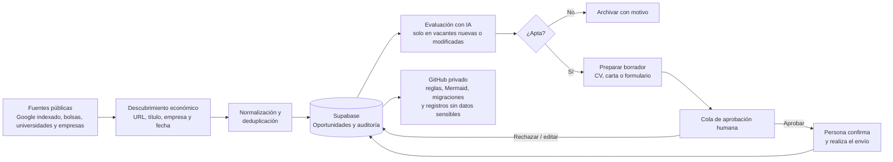
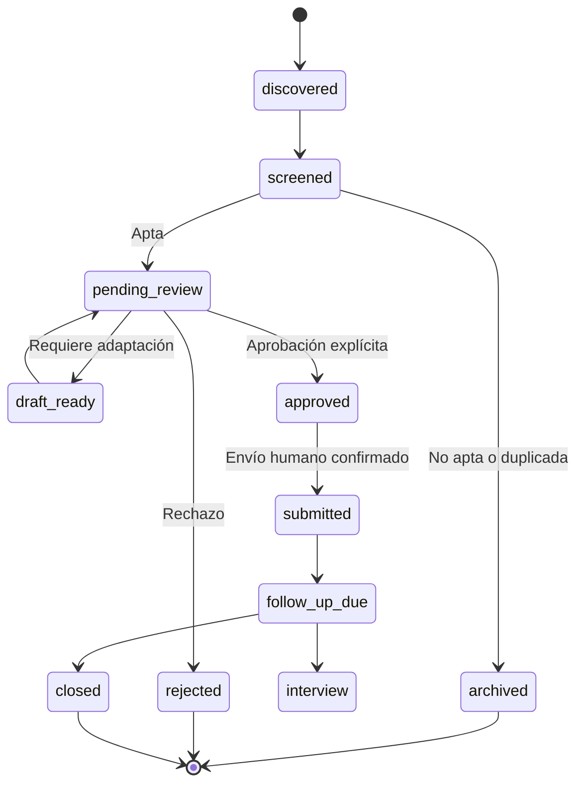
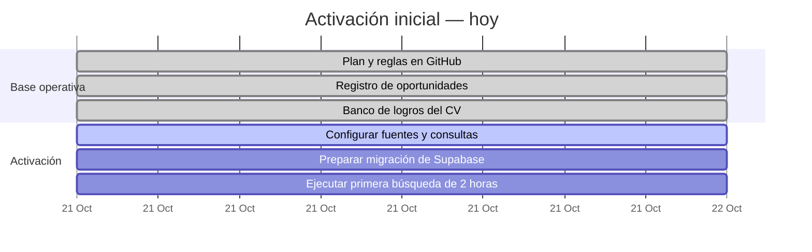

# Plan del agente de búsqueda de empleo — Panamá

> Estado: planificación inicial · Última actualización: 21 de octubre de 2026

## Propósito

Construir un sistema personal y persistente que encuentre, clasifique y dé seguimiento a oportunidades de marketing en Panamá mientras María Fernanda trabaja o estudia. El sistema reduce el trabajo repetitivo, conserva evidencia y prepara borradores, pero mantiene el control humano sobre toda postulación y comunicación externa.

La meta no es enviar solicitudes por volumen. Es crear una cola corta de vacantes vigentes y relevantes, con CV adaptado y contexto suficiente para decidir bien.

## Perfil y reglas de selección

| Criterio | Regla inicial |
| --- | --- |
| Familias de puestos | Marketing, mercadeo, marketing digital, campañas, contenido, comunicación, CRM, performance, social media, automatización e IA aplicada a marketing. |
| Ubicación | Ciudad de Panamá; remoto o híbrido cuando sea viable. |
| Jornada | Tiempo completo; preferencia por lunes a viernes y sin sábado regular. |
| Salario mínimo de evaluación | US$900 al mes cuando el salario esté publicado. |
| Aspiración declarada en postulaciones | US$1,200 o más, salvo una decisión específica distinta. |
| Antigüedad | Priorizar anuncios publicados durante los últimos 7 días. |
| Salario no publicado | Marcar como `por confirmar`; no descartar solo por esa razón. |

## Fuentes de búsqueda

| Fuente | Frecuencia durante el piloto | Método |
| --- | --- | --- |
| Google con resultados indexados de LinkedIn | Diario | Consultas `site:linkedin.com/jobs/view` con los términos del perfil. No iniciar sesión ni automatizar LinkedIn. |
| Computrabajo, Konzerta y Encuentra24 | Diario | Buscar por familia de puesto, fecha y Ciudad de Panamá. |
| Empleos Panamá / MITRADEL | Diario | Revisar puestos de marketing, comunicación y administración. |
| Bolsas universitarias: Universidad del Istmo, UTP, UIP y USMA | Martes y jueves | Revisar ofertas para graduados y puestos generales. |
| Páginas de carrera de empresas | Miércoles | Confirmar el anuncio en la fuente primaria. |
| Facebook Marketplace y grupos públicos | Dos veces por semana | Evaluar solo anuncios verificables; confirmar empresa y condiciones antes de pasar a revisión. |

### Consultas seguras para la fuente indexada

```text
site:linkedin.com/jobs/view (marketing OR mercadeo OR "marketing digital") "Panama City"
site:linkedin.com/jobs/view (CRM OR campañas OR contenido OR comunicación) Panamá
site:linkedin.com/jobs/view ("marketing manager" OR "coordinador de marketing") Panamá
```

Un enlace indexado puede ser antiguo. Antes de preparar una postulación, se comprueba que la vacante siga disponible en la fuente original.

## Flujo y puntos de aprobación



| Acción | Automatización | Aprobación humana |
| --- | --- | --- |
| Encontrar, leer y registrar anuncios públicos | Permitida | Opcional |
| Deduplicar y puntuar oportunidades | Permitida | Puede corregirse |
| Preparar cambios de CV, carta o formulario | Permitida como borrador | Obligatoria |
| Completar campos no sensibles | Fase futura, siempre visible como borrador | Obligatoria |
| Enviar formulario, correo o mensaje | Bloqueado | Obligatoria y explícita |
| Compartir CV, teléfono, correo u otros datos | Bloqueado | Obligatoria y explícita |

## Estado de una oportunidad



## Priorización

| Señal | Puntos |
| --- | ---: |
| Salario publicado de US$900 o más | +30 |
| Ciudad de Panamá, híbrido o remoto | +20 |
| Lunes a viernes o sin sábado habitual | +15 |
| Publicada hace 7 días o menos | +15 |
| Requisitos alineados con experiencia verificable | +20 |
| Salario no publicado | 0; marcar `por confirmar` |
| Empresa no verificable, condiciones confusas o señal de fraude | Bloqueo manual |

Con 60 puntos o más, el sistema prepara una ficha para revisión. Entre 40 y 59, conserva la vacante como opción secundaria. Por debajo de 40, archiva con el motivo.

## Ejecución de hoy



Hoy se deja todo lo que no dependa de una cuenta externa listo para usar. Los únicos pasos que pueden requerir intervención son conectar un proyecto Supabase y entregar el PDF del CV para completar los logros con métricas reales.

La primera búsqueda se ejecuta en un bloque de dos horas:

```mermaid
gantt
  title Bloque diario de 120 minutos
  dateFormat HH:mm
  axisFormat %H:%M
  section Detectar
  Google indexado y bolsas principales :09:00, 35m
  section Decidir
  Deduplicación y puntaje              :09:35, 25m
  section Preparar
  Borradores para mejores vacantes     :10:00, 35m
  section Cerrar
  Aprobaciones y seguimiento           :10:35, 25m
```



Después de validar esta primera ejecución, el agente usará un ciclo de bajo costo durante las horas laborales: consultar fuentes en intervalos escalonados, guardar huellas de cambios y llamar a IA únicamente para una vacante nueva o cambiada. La revisión humana seguirá ocurriendo en una o dos ventanas cortas al día.

## Registro y respaldo

GitHub conserva la documentación, Mermaid, migraciones y registros operativos sin información privada. Supabase guarda los datos vivos: vacantes, deduplicación, puntajes, estados, aprobaciones y eventos de seguimiento. Documentos personales, credenciales y CVs con datos sensibles no se publican en GitHub.

El esquema de Supabase debe contener, como mínimo: `search_sources`, `opportunities`, `approval_tasks` y `application_events`, con políticas RLS que limiten cada registro a su propietaria.

## CV y banco de logros

Se mantendrán un CV maestro, versiones por familia de puesto y un banco de logros comprobables. Próximas incorporaciones cuando se entregue el PDF:

- Caso de éxito de la campaña del Día de las Flores: objetivo, rol, periodo, canales, inversión si es pública y métricas antes/después.
- Automatización de agentes de IA para campañas y reportes: proceso anterior, herramientas, tareas automatizadas, revisión humana y resultado medible.

No se atribuirán métricas, resultados ni experiencia que no estén respaldados por información proporcionada por María Fernanda.
